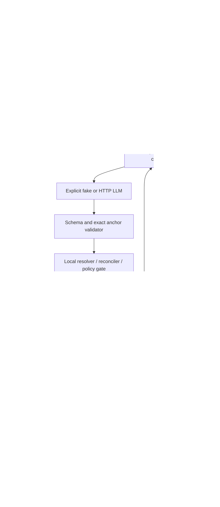

# Architecture

Current implementation: stage 5 prototype. [SPEC.md](SPEC.md) retains the broader target contract; [validation](docs/VALIDATION.md) distinguishes tested behavior from partial/unmeasured requirements.



## Source lifecycle

`cli.scan` snapshots eligible sources. `sources.collect_sources` defines eligibility for both scan and `publication.check_sources`: UTF-8 `.md/.txt`, no binary NUL, explicit maximum bytes, no symlinks/linked ancestors, hidden directory trees or application data tree. It returns metadata, not all source bytes; scan rereads/verifies one document at a time. Discovery metadata and the local ledger are still collection-sized in memory; this is not a streaming large-vault implementation.

`collections`, `documents`, `source_revisions`, `revision_metadata` and `chunks` preserve history. Schema4 adds `collection_scans` (pinned policy and intake warnings) and `scan_membership` (current valid document/revision set). Rescanning replaces only membership, including an empty all-invalid result. `last_revision_id` remains a historical projection, never the source of current plan membership. Schema3 rows cannot establish current membership automatically; rescan is required after migration. Migrations are transactional/additive and preserve IDs, snapshots and prior workflow tables.

Collection/document/revision/chunk IDs retain the original deterministic `prefix_SHA256` encoding. Absolute source location and explicit selection intent are part of identity. Content hashes are integrity checks and revision keys, not cross-document identity. Snapshot bytes and chunk offsets retain UTF-8 BOM. Byte/heading/paragraph chunking is deterministic but does not promise tokenizer-aligned boundaries.

## Extraction and context

`planner.plan` fixes a manifest, committed ledger revision and config hash to derive job/ChangeSet IDs. Jobs isolate staged entities/aliases/mentions/claims/evidence membership. `chunk_checkpoints` atomically retain only successfully validated chunks. A completed identical plan returns its persisted artifact; an interrupted invocation skips completed chunks.

`LLMProvider.generate_structured` returns proposals only. `FakeLLM` is an explicit fixture, not an extractor. `OpenAICompatibleLLM` uses stdlib urllib to call `/chat/completions`, supplies a versioned JSON Schema in the system messages and requests JSON-object mode. Local validation is authoritative; the adapter grants no tools, functions, backend credentials or storage access. Remote selection requires explicit endpoint/model/env secret and HTTPS. Loopback HTTP/no-key operation requires `--llm-local`. Redirects are not followed.

`context.bounded_messages` measures the complete JSON body used by the HTTP adapter, including JSON escaping, model, prompts, schema, source, metadata, context and retry feedback. Oversized context entries are omitted whole, caps are applied with original/omitted counts, and further context tails are dropped until the body fits. Exact source text is retained; an oversized minimum request becomes `needs_attention` without a send. The default ceiling is 65536 bytes, with separate staged digest and per-entry limits. This is not a tokenizer budget. Full local identity resolution and canonical matching always use all ledger rows; prompt truncation does not truncate those indexes.

Default context is explicitly offline. Optional `ObserveContextProvider` performs bounded health/observe GET/ACTIVATE with local fallback and limited snippets. Full credentials are absent. Native name records do not define local canonical IDs. Retrieved `relevant_engrams` are unstructured possible matches; they do not become a complete structured external-candidate semantic gate. Explicit structured candidates can conservatively trigger defer; legacy semantic reconciliation remains partial.

Initial call plus two retries are owned by the planner, with no adapter retry multiplication. Schema/anchor/provider failure leaves the chunk incomplete and records fixed safe codes. Resume requires original provider/model/context identities and config hashes, source policy/manifest/snapshots, and committed revision; request/digest budgets are reused from the job. Schema/prompt hashes and context/wire versions prevent silent configuration drift. Provider numeric usage can be retained, while pricing/cost is unmeasured.

## Grounding and identities

`contracts.py` validates bounded typed extraction, references, qualifiers, dates and finite values. `evidence.py` establishes quote offsets against immutable snapshot bytes; model-supplied offsets are never trusted. Frontmatter/link syntax is not interpreted as structured identity evidence. `resolution.py` applies grounded/scoped alias rules, handles name collisions and sensitive person/account/pet identities conservatively, and produces unresolved/fuzzy shortlists instead of name-only merges.

`planner.py` canonicalizes typed claim objects, predicates, qualifiers, polarity, modality and time. Equal canonical claims reinforce evidence or skip duplicate spans. Simple lexical source guards and time/conflict rules defer uncertainty and contradictions; they do not implement arbitrary-language entailment or a temporal reasoner. Missing/changed evidence yields `possibly_stale_source`, preserving old claims and snapshots.

## Review and publication

ChangeSet JSON is immutable and hash-checked against job config/manifest, independent staged operations and exact evidence. Review decisions live separately with actor/rationale/UTC timestamp and append-only history. Dependency batches are validated; unsafe defer/conflict operations cannot be promoted by review. Commit requires explicit actor and confirmation before preparing a session/backend.

`commit.py` is the sole publication service. A nonblocking OS-account vault lock serializes writers; Linux `flock` and filesystem ownership/no-symlink checks are tested. Other OS accounts/hosts and independently authoritative ledgers are outside this guarantee. Unsupported lock platforms fail with a fixed code. The model has no reference to the writer/backend API.

Before writes, `publication.py` revalidates the original artifact/config, current valid source membership under the original max-bytes policy, original bytes/snapshots, operation dependencies and ledger revision/preconditions. New valid files and changed/missing/newly ineligible valid files fail `stale_source`; still-skipped files may remain skipped.

Publication state:

```text
prepared → attempting → known ID → exact read-back → applied
                   ↘ unknown outcome → reconcile / needs_manual_repair
```

`commit_sessions` pin backend identity, config/artifact hashes, confirmation and expected committed revision. The durable outbox exists before POST; attempts/known IDs/read-back are persisted separately. Local projection and applied status are atomic. An interrupted operation reconciles before any retry. FakeBackend can prove marker absence exhaustively for offline tests. Pinned MuninnDB cannot: unknown outcome never triggers another POST, and manual known-ID repair requires an exact vault-bound read-back. Definitive 4xx is terminal/manual too; unresolved attempts block fresh sessions in that vault. There is no abandon action.

One authoritative ledger per backend/vault is required. Alias/evidence reinforcement changes only local indexes. Previous engrams are never updated, deleted, merged or evolved. `complete_with_deferred` preserves all unapplied decisions for inspection; it does not imply every proposal was published.

## Data and diagnostics

SQLite/snapshots/reports are local plaintext and can contain sensitive source quotes. LLM requests can contain exact source chunks, local locators/headings/IDs, scoped committed/staged context and optional retrieved snippets. Backend credentials never enter prompts/config/reports. LLM authentication is an HTTP header to the selected endpoint only. Response errors/events use allowlisted codes; raw provider bodies and keys are not logged. Context events retain request hashes/byte/omission counts and retrieval IDs rather than text. Status exposes a bounded event timeline; semantic quality, hidden backend cognitive feedback and real-LLM production performance remain unmeasured.
